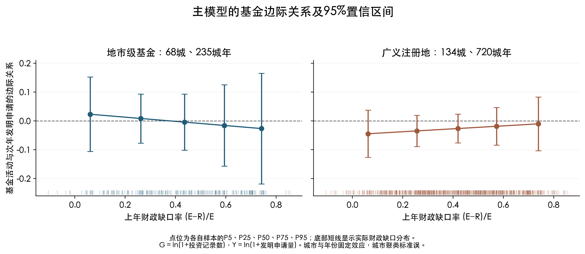

# 财政约束、基金投资配置与后续创新：分支试验结果

2026年11月17日 · `codex/fiscal-fund-innovation-20261117`

本次重估发现，财政缺口与地市级基金活动强度呈负向关系；“财政约束压低早期投资占比，并削弱基金与后续创新的关系”尚未得到一致支持。最明确的改进来自数据口径修复：原“财政压力”变量实际是财政自给率，城市名称处理漏配了40个城市的GDP，基金金额单位也存在标签错误。新分支完成了独立数据构建、固定规格估计、完整结果导出和复核。

## 一、三个核心问题的结果

主样本采用目录明确标记为地市级、注册城市可识别的基金，财政缺口为上年 `(支出−收入)/支出`。以下结果均包含城市和年份固定效应，标准误按城市聚类。

| 研究问题 | 目标系数 | 95%置信区间 | 原始p值 | 三项核心检验Holm校正p值 | 城年／城市 |
|---|---:|---|---:|---:|---:|
| H1：财政缺口是否降低基金活动与次年发明申请的斜率？ | −0.0728 | [−0.4723, 0.3266] | 0.717 | 1.000 | 235／68 |
| H2：财政缺口是否降低早期投资占比？ | 0.0326 | [−0.9579, 1.0230] | 0.948 | 1.000 | 296／74 |
| H5的活动强度检验：财政缺口是否降低投资记录数？ | −1.7154 | [−3.3908, −0.0400] | 0.045 | 0.135 | 296／74 |

财政缺口提高10个百分点，对应 `ln(1+投资记录数)`下降0.172。该关系出现在有投资记录的城市年份；三项核心检验联合校正后，证据尚未达到5%水平。H5关于投资金额的判断还需要更完整的金额披露。

H1的主估计没有形成稳定的负向交互关系。财政缺口处于样本P25、P50和P75时，基金活动的边际关系分别为0.0086、−0.0040和−0.0156，三个置信区间均覆盖零。

图中主模型投资年份为2015—2022年，创新结果为2016—2023年；底部短线表示实际财政缺口分布。图中纵轴是 `ln(1+投资记录数)`与次年 `ln(1+发明专利申请量)`的条件斜率。

## 二、机制与敏感性结果

早期投资结构的各项检验结论一致：现有样本未显示财政缺口扩大后早期比例下降。按阶段已知笔数加权后，缺口系数为0.0681（p=0.899）；加入电子信息、生物医疗占比与行业已知比例后为0.1513（p=0.740）。早期比例与次年发明申请的系数为−0.0235（p=0.657）。因此，“财政缺口—早期比例—创新”的链条各环节尚未连通。

| 补充检验 | 地市级样本目标系数 | p值 | 城年／城市 | 解释 |
|---|---:|---:|---:|---|
| 共同预测期样本：一年后申请（I3） | 0.1155 | 0.529 | 196／62 | 与两年后结果使用同一批城市年份 |
| 共同预测期样本：两年后申请（I4） | 0.1505 | 0.499 | 196／62 | 延长预测期未出现负向交互关系 |
| 债务共同样本：财政交互（I5） | 0.1131 | 0.549 | 194／60 | 主样本负号对样本构成敏感 |
| 基金×财政缺口×债务（I6） | 0.0027 | 0.935 | 194／60 | 未显示债务强化削弱效应 |
| 加入上年科技支出（I7） | −0.0613 | 0.767 | 235／68 | 主样本与I2完全一致 |
| 次年发明授权（I8） | −0.2091 | 0.096 | 235／68 | 探索性负向线索，95%区间覆盖零 |
| 纳入2024年申请结果（I10） | −0.1056 | 0.575 | 272／73 | 主结论保持一致 |

三阶交互模型包含基金、财政、债务的全部低阶项。在债务比例P25、P50、P75处，财政对基金斜率的调节分别为0.0672、0.0692和0.0747，95%区间均覆盖零。早期比例模型中的财政×债务系数为0.0431（p=0.448），同样没有显示预期的强化关系。

广义注册地样本纳入所有基金级别，用于检查地理归属口径的敏感性。主创新交互项为0.0508（p=0.640）；早期比例的缺口系数为−0.2911（p=0.193）；基金活动系数为0.2159（p=0.713）。地市级样本中的活动强度负相关没有在广义口径重现。两种口径同时改变基金层级和样本组成，差异应结合实际财政出资辖区继续核验。

地市级完整披露金额样本在移除单期城市后只有38个城年、18个城市，低于事先设定的40观测、20聚类门槛，该规格按规则跳过。广义口径的金额系数为14.1732（p=0.003，117个城年、46个城市），呈正向关系。金额结果对应全部事件均披露的选择性子样本，不能概括为投资金额普遍压缩。全部36个规格及跳过原因见[完整规格结果](完整规格结果.md)。

## 三、此次修复的数据口径

| 项目 | 核验发现 | 本次处理 |
|---|---|---|
| 财政变量方向 | 原始“财政收支压力”7450个有效值全部等于收入／支出 | 从原始收入、支出计算缺口率 `1−R/E`，保留原始收支与自给率 |
| 城市名称 | 旧程序漏配39个以“州”结尾的城市简称，另有吉林市简称与省名混同 | 按现有城市清单匹配全名和简称，恢复40城、400个GDP城年 |
| 债务量纲与滞后 | 源表债务／收入为百分数；2021年有效覆盖仅30城 | 除以100；按城市与日历年精确匹配，不跨缺失年份取上一行 |
| 投资记录去重 | 原匹配表24306行，含2条完全重复、1条错位表头 | 保留24303条有效记录；匿名企业的不同地区、阶段记录分别保留 |
| 财政归属 | 原表有基金级别、注册地和企业地，缺少实际出资或主管财政辖区 | 地市级＋注册地为主代理，企业地另列；逐基金输出待核验清单 |
| 事件与金额缺失 | 有效事件中12402条未披露金额；旧主面板把百万元标为万元 | 无记录年份不补零；金额保持百万元，完整披露金额与披露部分加总分别记录 |
| 投资阶段 | 已知阶段含种子、初创、扩张、成熟 | 早期占比用种子＋初创除以已知阶段笔数，未知阶段不进入分母 |
| 人口与专利 | 人口源表存在数量级异常；发明申请、授权各2720值与仓库CNRDS原始导出表一致 | 主控制采用上年GDP对数、二产占比；科技支出单列敏感性 |

主基金样本共有1086条投资记录、110个城市、334个有记录城年。其中668条未披露金额，2条阶段未知，833条被投企业与基金注册城市相同；170个城年仅有1条记录。主创新估计进一步要求宏观变量和后续专利齐全，移除只有一个有效年份的城市，最终为235个城年、68个城市。

可用金额包含源表标注的估算值，估算标记单独保留；全部有效事件中共有291条此类记录。“完整披露金额”表示该城年每条记录均有可用金额，仍可能包含源表估算值。

宏观面板沿用现有277城范围，并补入2014年以构造2015年的前定变量。2024年发明申请总量较2023年下降25.38%，总申请下降59.27%，发明授权上升14.60%；原始资料未解释这组变化。回归前固定以结果年截至2023为主、纳入2024为敏感性，两个版本均完整报告。

## 四、研究设计与结论范围

主模型为：

\[
\ln(1+\mathrm{发明申请}_{i,t+1})=\alpha_i+\lambda_t+
\beta G_{it}+\theta P_{i,t-1}+\delta G_{it}P_{i,t-1}
+\gamma_1\ln GDP_{i,t-1}+\gamma_2\mathrm{二产占比}_{i,t-1}+\varepsilon_{it}.
\]

其中 `G=ln(1+基金投资记录数)`，`P=(财政支出−财政收入)/财政支出`。固定预测期下，投资年与结果年固定效应只是年份标签平移。财政与宏观控制变量均滞后一期；B4另外控制当期投资行业构成。预测期、债务及科技支出比较设置了相应共同样本。B3使用加权固定效应，其余模型使用普通城市内固定效应。所有系数、95%区间、逐模型样本与数据哈希均保存。

估计描述有观察投资记录的城市年份内部随时间变化的条件关联。注册地是财政辖区的代理；主样本约76.7%的记录投资于本地企业，跨城投资仍使基金行为与本地专利之间存在地理差异。财政缺口反映本级收入对支出的覆盖，转移支付、可用财力和实际基金出资需要另外观测。基金投资选择、创新项目供给以及财政变化的共同决定，需要进一步识别。本次脚本不插补或缩尾，财政工作簿的上游填补方法未注明；全部规格按固定规则报告。

## 五、中期材料可采用的表述

> 项目完成了财政、基金投资和城市创新数据的口径核验，修正了财政压力方向、城市名称匹配和基金金额单位，并建立了前期财政约束、当期基金活动与后续创新的时间对应关系。在地市级基金样本中，财政缺口与投资活动强度呈负向关系，但多重检验校正后的证据尚未达到5%水平。财政约束降低早期投资占比、削弱基金与后续创新关系的假说，尚未获得一致支持。下一阶段重点核验实际财政出资辖区、补充基金出资及项目选择信息，并完善因果识别。

下一步最能提高研究解释力的工作，是沿[逐基金核验清单](fund_mapping_review.csv)补齐出资和主管财政辖区，获取认缴、实缴及延期出资数据，并核实无投资记录年份的覆盖范围。私人VC挤出与退出期限分别需要私人投资和退出日期数据；早期投资比例继续用于阶段配置检验。

## 六、复现与文件

本次共设置36个规格，35个完成估计，1个按样本门槛跳过。完整系数见[all_coefficients.csv](all_coefficients.csv)，核心校正见[core_tests_holm.csv](core_tests_holm.csv)，边际关系见[marginal_effects.csv](marginal_effects.csv)，审计见[event_audit.json](event_audit.json)和[macro_audit.json](macro_audit.json)，独立复核见[validation.json](validation.json)。

复现步骤和环境要求见[README](README.md)。报告依据本次实际运行结果撰写，采用用户提供的 anti-defensive-writing 规范。
